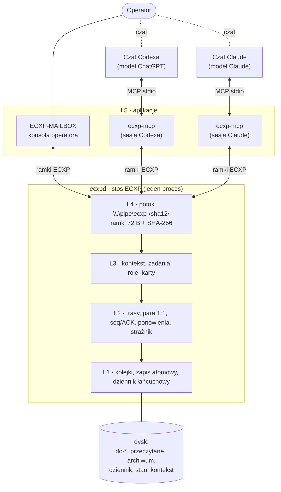
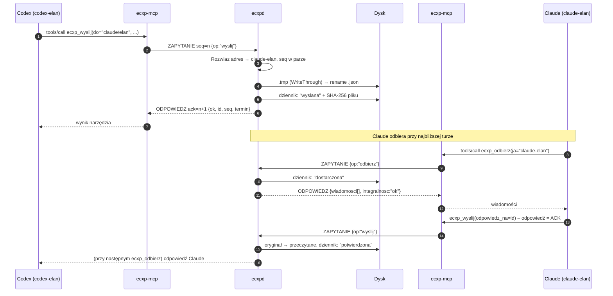

# 01 – Architektura

## Warstwy

ECXP jest zbudowany jak stos sieciowy. Każda warstwa korzysta tylko z warstwy pod sobą.

| Warstwa | Odpowiedzialność | Odpowiednik | Gdzie w kodzie |
|---|---|---|---|
| L5 aplikacja | konsola operatora, adaptery dla modeli | aplikacje | `ECXP-MAILBOX.cs`, `Mcp.cs` |
| L4 łącze klient↔stos | ramka binarna, potok nazwany, uzgadnianie, zapytania, wypychanie | gniazdo + TCP lokalnie | `Ramka.cs`, `Ecxpd.cs` |
| L3 kontekst i zadania | części, obiekty adresowane skrótem, zadania, role, karty | A2A (Task, Part, Agent Card) | `Protokol.cs` (warstwa 3), `Siec.cs` (role) |
| L2 sieć i niezawodność | adresy, trasy, para 1:1, seq, ACK, ponowienia, eskalacja | IP + TCP między agentami | `Siec.cs`, `Protokol.cs` |
| L1 trwałość | kolejki na dysku, zapis atomowy, dziennik łańcuchowy, blokada | nośnik | `Protokol.cs` |



## Procesy

| Proces | Rola | Liczba | Uruchamia |
|---|---|---|---|
| `ecxpd.exe` | stos: **jedyny proces piszący w skrzynce**, serwer potoku, zegary, strażnik | 1 na katalog skrzynki | konsola albo adapter, gdy stosu nie ma |
| `ECXP-MAILBOX.exe` | konsola operatora, klient z rolą `operator` | 1 (mutex) | Autostart Windows |
| `ecxp-mcp.exe` | adapter MCP: JSON-RPC 2.0 na stdio ↔ ramki ECXP | 1 na sesję modelu | klient MCP (Codex, Claude Code) |

- **Nazwa potoku**: `ecxp-` + pierwsze 12 znaków szesnastkowych SHA-256 pełnej ścieżki katalogu skrzynki (małe litery, bez końcowego `\`). Kilka niezależnych instalacji na jednym komputerze nie koliduje.
- **Uruchamianie na żądanie**: klient łączy się co 400 ms. Gdy stosu nie ma, raz uruchamia `ecxpd.exe /root "<katalog>"` i próbuje dalej przez najwyżej 45 s, bo pierwszy start nowego, niepodpisanego programu może opóźnić skaner antywirusowy. Potem zgłasza błąd zamiast zapisać plik z pominięciem stosu.
- **Bez dziedziczenia uchwytów**: stos jest uruchamiany przez `CreateProcess` z `bInheritHandles = false`, bez powłoki Windows. Nie przejmuje stdin/stdout adaptera MCP, więc gospodarz MCP widzi koniec adaptera.
- **Ponawianie uzgodnienia**: gdy połączenie zostanie zerwane w trakcie HELLO/WITAJ (np. tuż po starcie stosu), klient ponawia uzgodnienie do 6 razy, z rosnącą przerwą. Odmowa stosu (RST) nie jest ponawiana.

## Przepływ wiadomości (przegląd)



## Układ katalogu skrzynki

```
<skrzynka>\
├─ do-codex\  do-claude\  do-wlasciciela\   kolejki (pliki <id>.json)
├─ przeczytane\                              potwierdzone
├─ archiwum\RRRR-MM\                         przeniesione przez operatora („Wyczyść”)
├─ dziennik\dziennik.jsonl                   dziennik łańcuchowy (append-only)
├─ dziennik\.blokada                         blokada międzyprocesowa
├─ stan\seq\<od>__<do>.txt                   liczniki seq w parach
├─ stan\wezly\<nazwa>.json                   sygnał życia węzłów
├─ stan\trasy.json                           tablica tras (para 1:1, role)
├─ stan\karty\  stan\role\  stan\start\      karty węzłów, definicje ról, pakiety startowe
├─ kontekst\obiekty\<2>\<sha256>             obiekty kontekstu (tylko do odczytu)
├─ projekty\<projekt>\projekt.json           konfiguracja projektu (moduły, pary)
├─ Odebrane\  Wysłane\                       widok dla człowieka: plik .txt na wiadomość (tworzy stos, tylko do odczytu)
├─ stan\widok.json                           indeks widoku (wiadomość → plik w Odebrane / Wysłane)
├─ stan\doreczanie.json                      próby budzenia adresatów i wysłane alarmy NIEDORECZONA
├─ stan\logi\mailbox-RRRR-MM-DD.jsonl        błędy i ostrzeżenia konsoli (tylko przy problemach)
└─ narzedzia\                                programy i źródła
```

Foldery `Odebrane` i `Wysłane` to widok, a nie kolejki protokołu. Stos (`Widok.cs`) zapisuje w nich jeden plik `.txt` na wiadomość, z nazwą `RRRR-MM-DD GG-MM · Rodzaj · TEMAT · od/do … · końcówka id.txt`, więc Eksplorator układa je według daty. W pliku są: nagłówek, treść, załączniki, kontrole, aktualny stan doręczenia u każdego adresata i miejsce oryginału.

- **Wysłane:** wiadomości operatora, także wpisy z czatu przekazane drugiej stronie pary.
- **Odebrane:** wszystkie pozostałe wiadomości (od agentów i strażnika).
- Wiadomość do pary to jeden plik, a kopie dla pary nie mają osobnych plików.
- Widok obejmuje archiwum. Plik jest przepisywany tylko po zmianie wiadomości albo jej stanu, a nic nie jest kasowane: plik po zmianie nazwy trafia do `poprzednie\`.
- Zmiana albo usunięcie pliku widoku niczego nie wysyła. Konsola ma w prawym menu „📂 Pokaż w folderze”.

## Dlaczego jeden proces piszący
- **Spójność.** Kolejność zdarzeń w dzienniku i liczniki seq nie zależą od wyścigów między procesami.
- **Szybkość.** Stos trzyma stan w pamięci i wypycha zmiany do podłączonych klientów, bez odpytywania folderów.
- **Kontrola.** Tylko stos rozpoznaje operatora i rozwiązuje adresy, więc adapter nie może ominąć reguł.

Blokada `dziennik\.blokada` (plik otwarty z `FileShare.None`, ponawianie co 25 ms, limit 10 s) zostaje jako zabezpieczenie dla narzędzi pracujących bezpośrednio na bibliotece, np. testu `/selftest`.
