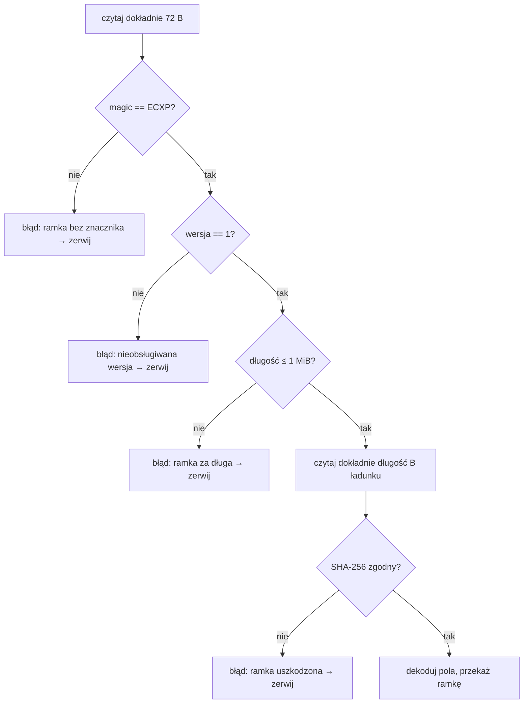

# 02 – Ramka ECXP

Stan: **[w budowie]**, kod w `Ramka.cs`.

## Układ bajtów

Nagłówek ma stałe **72 bajty**, wszystkie liczby są **little-endian**. Ładunek ma od 0 do 1 MiB (1 048 576 B).

```
 0               4   5   6       8                               16
 ├───────────────┼───┼───┼───────┼───────────────────────────────┤
 │ magic "ECXP"  │ver│typ│ flagi │        połączenie (u64)        │
 ├───────────────┴───┴───┴───────┴───────────────────────────────┤
16                               24                              32
 │            seq (u64)          │            ack (u64)          │
 ├───────────────┬───────────────┼───────────────────────────────┤
32              36              40                              72
 │  okno (u32)   │ długość (u32) │   skrót SHA-256 (32 B)  ...   │
 ├───────────────┴───────────────┴───────────────────────────────┤
72
 │ ładunek: JSON UTF-8 (bez BOM), długość = pole „długość”  ...   │
 └────────────────────────────────────────────────────────────────┘
```

| Przesunięcie | Rozmiar | Pole | Znaczenie |
|---|---|---|---|
| 0 | 4 | `magic` | ASCII `E` `C` `X` `P` (0x45 0x43 0x58 0x50) |
| 4 | 1 | `wersja` | 1 |
| 5 | 1 | `typ` | typ ramki (tabela niżej) |
| 6 | 2 | `flagi` | maska bitowa (tabela niżej) |
| 8 | 8 | `polaczenie` | identyfikator połączenia nadany przez stos w WITAJ |
| 16 | 8 | `seq` | numer kolejny nadawcy w tym połączeniu |
| 24 | 8 | `ack` | potwierdzenie skumulowane: odebrano wszystko do `ack − 1` |
| 32 | 4 | `okno` | ile ramek odbiorca przyjmie bez potwierdzenia (domyślnie 16) |
| 36 | 4 | `dlugosc` | długość ładunku w bajtach, 0 … 1 048 576 |
| 40 | 32 | `skrot` | SHA-256(bajty 0–39 ‖ ładunek) |
| 72 | n | `ladunek` | JSON UTF-8 |

## Skrót

```
skrot = SHA-256( naglowek[0..39] ‖ ladunek[0..dlugosc-1] )
```

Skrót obejmuje wszystkie pola nagłówka przed sobą i cały ładunek. Odbiorca przelicza go po odczytaniu całej ramki. Niezgodność oznacza ramkę uszkodzoną: połączenie jest zrywane, a klient łączy się ponownie.

## Typy ramek

| Kod | Nazwa | Kierunek | Flagi | Ładunek |
|---|---|---|---|---|
| 1 | `HELLO` | klient → stos | SYN | `{ja, rodzaj, protokol, pid}` |
| 2 | `WITAJ` | stos → klient | SYN\|ACK | `{ja: przyznana nazwa, …}` |
| 3 | `ZAPYTANIE` | klient → stos | PSH\|ACK | `{op, args}` |
| 4 | `ODPOWIEDZ` | stos → klient | ACK | `{ok, wynik}` albo `{ok:false, blad}`; `ack` = seq zapytania + 1 |
| 5 | `DANE` | stos → klient | PSH | zdarzenie wypychane (nowa wiadomość, zmiana stanu) |
| 6 | `ACK` | obie | ACK | pusty |
| 7 | `PING` | obie | – | pusty |
| 8 | `PONG` | obie | ACK | pusty |
| 9 | `BLAD` | stos → klient | – | `{blad}` |
| 10 | `FIN` | obie | FIN\|ACK | pusty |
| 11 | `RST` | obie | RST | `{blad}` (opcjonalnie) |

## Flagi

| Bit | Wartość | Nazwa | Znaczenie |
|---|---|---|---|
| 0 | 0x0001 | `SYN` | otwarcie połączenia, niesie ISN w `seq` |
| 1 | 0x0002 | `ACK` | pole `ack` jest ważne |
| 2 | 0x0004 | `FIN` | zamknięcie po stronie nadawcy |
| 3 | 0x0008 | `RST` | zerwanie połączenia |
| 4 | 0x0010 | `PSH` | przekaż od razu do aplikacji |
| 5 | 0x0020 | `PILNE` | priorytet (wiadomość pilna) |
| 6–15 | – | – | zarezerwowane, nadawca wpisuje 0 |

## Odczyt ramki (algorytm odbiorcy)



„Czytaj dokładnie” oznacza pętlę, aż przyjdzie żądana liczba bajtów. Koniec strumienia przed czasem to zamknięte połączenie.

## Przykład: ramka PING

Połączenie `0x2A`, seq `5`, ack `9`, okno `16`, bez ładunku:

```
45 43 58 50  01  07  00 00  2A 00 00 00 00 00 00 00
05 00 00 00 00 00 00 00  09 00 00 00 00 00 00 00
10 00 00 00  00 00 00 00  <32 B: SHA-256 bajtów 0–39>
```

## ISN

Początkowy numer kolejny (ISN) to 64-bitowa liczba losowa z `RandomNumberGenerator`, przesunięta o 16 bitów w prawo. Zostaje zapas na przyrosty bez przepełnienia, a numery są nieprzewidywalne między połączeniami.

## Ładunek

- JSON UTF-8 bez BOM. Większe dane (pliki, logi, dyfy) nie idą w ramce, tylko jako **obiekty kontekstu** adresowane SHA-256 (patrz [06](06-kontekst-i-zadania.md)), pobierane porcjami.
- Limit 1 MiB chroni stos i kontekst modelu przed pojedynczą przerośniętą ramką.
