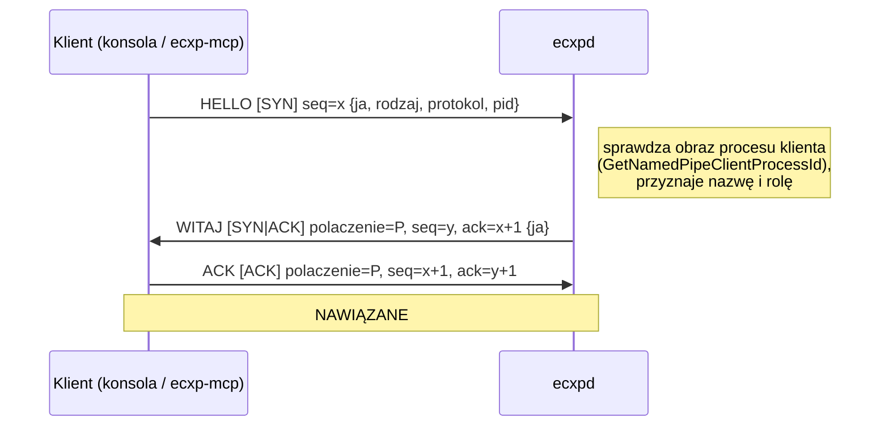
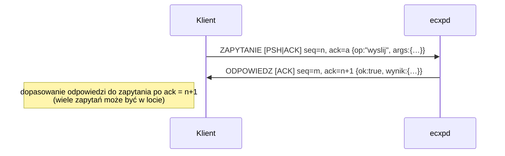
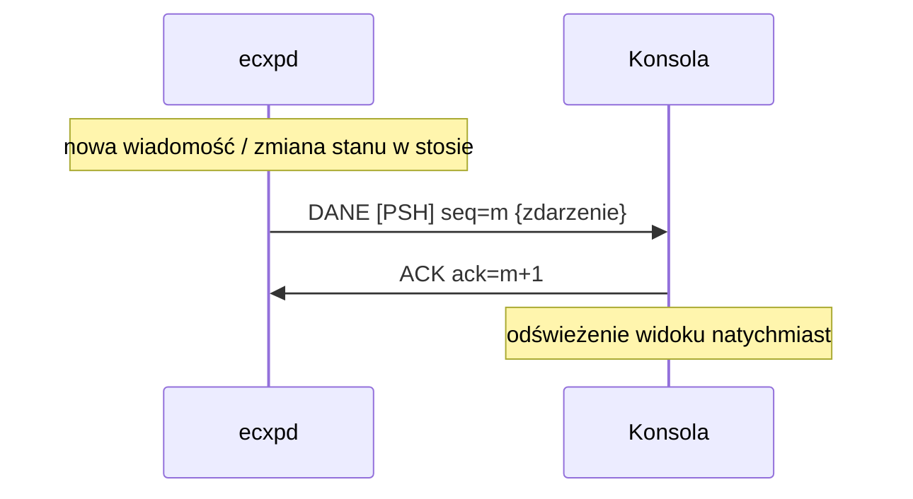
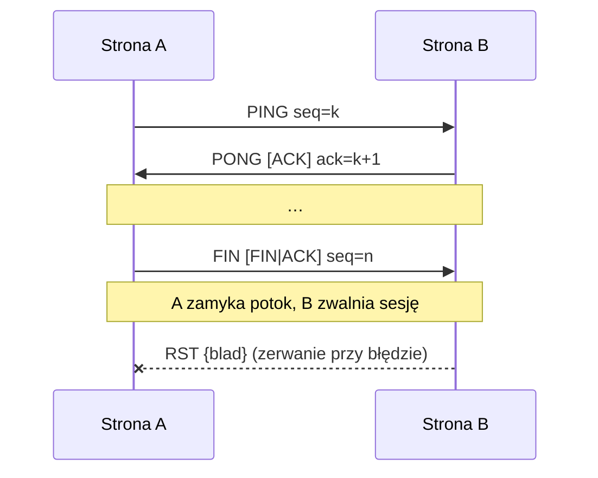
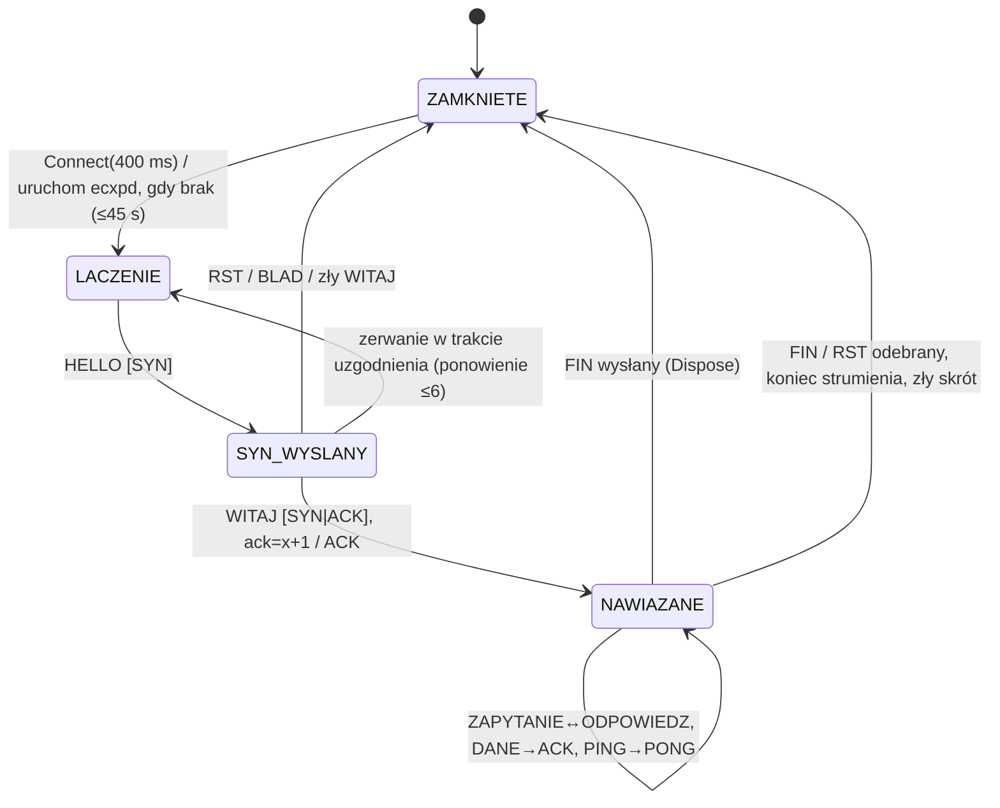

# 03 – Połączenia

ECXP ma dwa poziomy połączeń:

1. **Łącze klient↔stos** (L4), lokalne, przez potok nazwany. Uzgadnianie, numeracja, wypychanie, zamykanie. **[w budowie]**
2. **Połączenie logiczne między węzłami** (L2), np. `wlasciciel ↔ codex-koordynacja` albo `codex-elan ↔ claude-elan`. Trwałe na dysku, przeżywa restart stosu i komputera, numerowane `seq` w parze. **[jest]** w zakresie seq/ACK/ponowień. Stany SYN/FIN na poziomie pary: **[plan]**.

## 1. Łącze klient↔stos

### Uzgadnianie trójstronne

Klient odrzuca uzgadnianie, gdy:
- odpowiedź nie jest typu WITAJ;
- nie ma kompletu flag SYN|ACK;
- `ack ≠ x+1`.

Stos odpowiada RST albo BLAD, gdy odmawia. Przykład: ktoś inny niż `ECXP-MAILBOX.exe` z katalogu skrzynki prosi o rolę operatora.

### Zapytanie i odpowiedź

- Klient czeka na odpowiedź z `ack = n+1`, domyślnie najwyżej 60 s. Brak odpowiedzi to błąd „stos nie odpowiedział w czasie”.
- `{ok:false, blad:"…"}` albo ramka BLAD dają po stronie klienta wyjątek z dokładnym opisem, np. „Para modułu 'elan' jest niepełna – brak sesji: Claude”.
- Operacje (`op`): `wyslij`, `odbierz`, `potwierdz`, `stan`, `watek`, `sygnal`, `przypisz`, `trasy`, `rola`, `nowe_zadanie`, `kontekst_zapisz`, `kontekst_pobierz`, `przekaz`, `zadanie`, `karta`, `archiwizuj`, `straz`, `ping`.

### Wypychanie (bez odpytywania)

### Utrzymanie i zamykanie

### Maszyna stanów łącza (strona klienta)

## 2. Połączenie logiczne między węzłami (para nadawca→adresat)

Numeracja i potwierdzenia między węzłami są trwałe na dysku. Patrz [04-niezawodnosc.md](04-niezawodnosc.md).

Projekt docelowego cyklu życia połączenia pary **[plan]**:

```mermaid
stateDiagram-v2
    [*] --> ZAMKNIETE
    ZAMKNIETE --> SYN_WYSLANY: pierwsza wiadomość (SYN niesie dane, jak TCP Fast Open)
    SYN_WYSLANY --> NAWIAZANE: adresat odebrał i potwierdził (SYN+ACK)
    SYN_WYSLANY --> RESET: brak potwierdzenia po ponowieniach → alarm u operatora
    NAWIAZANE --> NAWIAZANE: wiadomości seq n, n+1, …; ACK skumulowany
    NAWIAZANE --> FIN_CZEKA: FIN (sprawa zakończona / sesja zamknięta)
    FIN_CZEKA --> ZAMKNIETE: ACK FIN
    NAWIAZANE --> RESET: rozbieżność, utrata sesji bez następcy
    RESET --> ZAMKNIETE: operator rozstrzyga
```

Węzły modelowe są **turowe**: działają tylko w czasie tury. Dlatego stos przechowuje SYN i dane do chwili, gdy adresat się odezwie, a uzgadnianie nie opóźnia pierwszej wiadomości.
