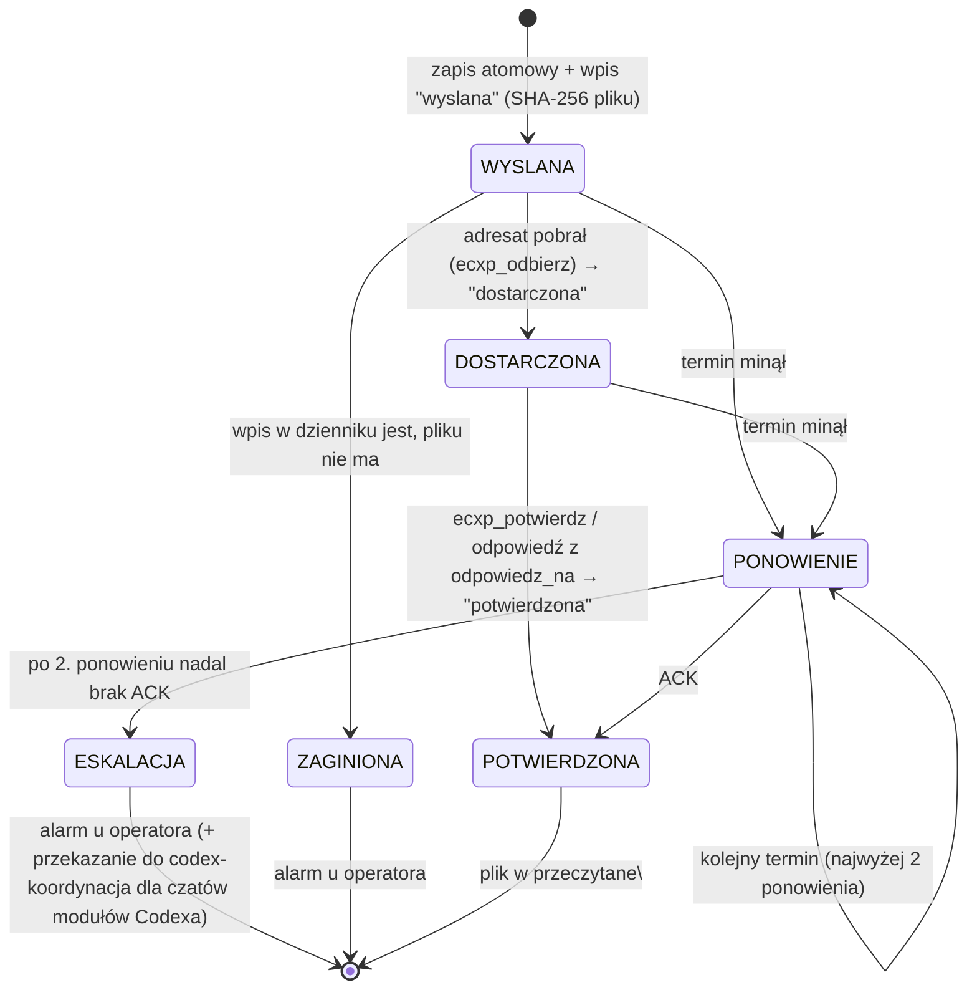
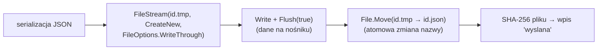
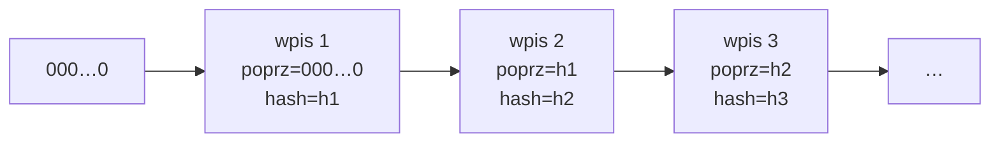
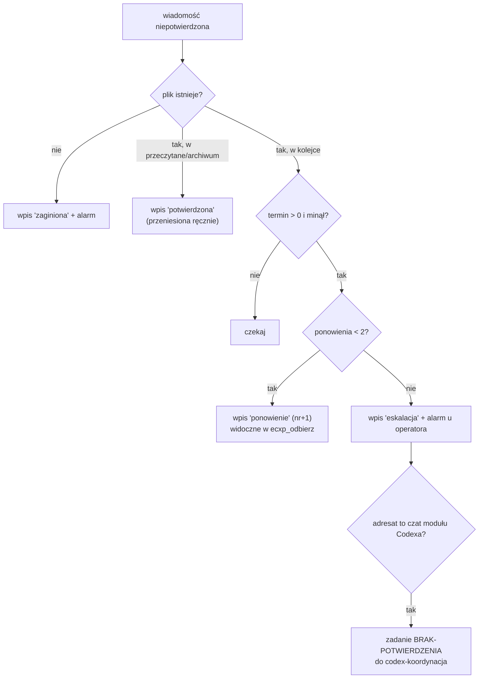

# 04 – Niezawodność

Gwarancja ECXP: **wiadomość zostaje potwierdzona przez adresata albo nadawca i operator dostają alarm z przyczyną. Ciche zgubienie jest niemożliwe.**

Ograniczenie: stos nie obudzi modelu, który nie ma otwartej tury. Wiadomość czeka trwale, a zegar ponowień wymusza reakcję operatora.

## Identyfikacja wiadomości [jest]

| Pole | Opis |
|---|---|
| `id` | `RRRRMMDD-GGMMSS-<moduł>-<TEMAT>-<4 hex losowe>`, jednocześnie nazwa pliku `<id>.json` |
| `seq` | numer kolejny w parze **nadawca→adresat**: licznik `stan\seq\<od>__<do>.txt`, zwiększany pod blokadą |
| `skrot` | `SHA-256(id ‖ "|" ‖ od ‖ "|" ‖ do ‖ "|" ‖ seq ‖ "|" ‖ tresc)` |
| `watek` / `kontekst_id` | identyfikator sprawy (pierwsza wiadomość wątku, lustro pary albo podany) |
| `odpowiedz_na` | `id` wiadomości, na którą to odpowiedź |
| `termin_potwierdzenia_min` | termin ACK zależny od adresata |

## Stany wiadomości



## Terminy potwierdzenia [jest]

| Adresat | Termin | Uzasadnienie |
|---|---|---|
| wiadomość pilna | 15 min | |
| `codex-koordynacja` (i `codex`, `codex-core`) | 30 min | automatyzacja co 10 min |
| czaty modułów Codexa, sesje Claude | 240 min | czytają między etapami pracy |
| `wlasciciel` | brak | pilnuje konsola: alarm wizualny |

Ponowienie liczy się od wysłania albo od ostatniego ponowienia. Projekt docelowy: odstęp RTO narastający wykładniczo (T, 2T, 4T) **[plan]**.

## Potwierdzenia [jest]

- **Jawne**: `ecxp_potwierdz(id, wynik)`, gdzie wynik to `obsluzona`, `przyjeta` albo `odrzucona` (z powodem). Powtórne potwierdzenie jest **idempotentne** i zwraca `juz_potwierdzona`.
- **Doklejone** (jak ACK w danych TCP): `ecxp_wyslij(odpowiedz_na=id)` od adresata oryginału potwierdza oryginał w tej samej operacji, pod tą samą blokadą.
- **Zgodność wstecz**: plik przeniesiony do `przeczytane\` bez narzędzia strażnik zapisuje jako potwierdzenie z adnotacją.
- Potwierdzić można tylko wiadomość zaadresowaną do siebie, czyli gdy `DoMnie(ja, do)` jest prawdziwe. Ogólny `codex` i `codex-core` obsługuje koordynacja, ogólny `claude` dowolna sesja Claude.

## Zapis atomowy [jest]



Czytelnik widzi tylko pliki `.json`, więc nigdy nie trafi na połowę zapisu. Plik `.tmp` starszy niż 2 min to przerwane wysyłanie, które `ecxp_odbierz` zgłasza jako ostrzeżenie.

## Dziennik łańcuchowy [jest]

Plik `dziennik\dziennik.jsonl` jest tylko dopisywany, a każdy wpis zajmuje jedną linię.

```
body_i  = JSON wpisu i, zawierający "poprz": hash_{i-1}  (hash_0 = 64 × "0")
hash_i  = SHA-256( hash_{i-1} ‖ body_i )
linia_i = body_i bez końcowego "}" ‖ ,"hash":"<hash_i>"}
```



Weryfikacja przechodzi wszystkie linie i dla każdej przelicza `SHA-256(hash_{i-1} ‖ body_i)`. Zmiana dowolnego bajtu wpisu albo usunięcie wpisu psuje wszystkie następne skróty. Konsola pokazuje wtedy „dziennik: NARUSZONY: wpis n …”.

Zdarzenia: `wyslana`, `dostarczona`, `potwierdzona`, `ponowienie`, `eskalacja`, `zaginiona`, `zarchiwizowana`, `zadanie`, `obiekt`, `karta`, `przypisanie`, `nowe_zadanie`.

Zapis każdego wpisu: `FileMode.Append` + `WriteThrough` + `Flush(true)`, pod blokadą.

## Strażnik [jest]

Strażnik uruchamia się co 15 s i przy każdej zmianie w skrzynce. Dla każdej wiadomości z wpisem `wyslana` bez `potwierdzona`:



## Integralność przy odbiorze [jest]

`ecxp_odbierz` zwraca dla każdej wiadomości pole `integralnosc`:
- `ok`: SHA-256 pliku zgadza się z wpisem `wyslana`, a `skrot` z treścią;
- `USZKODZONA: plik zmieniony po wysłaniu`, `USZKODZONA: skrót treści się nie zgadza` albo `USZKODZONA: zły JSON`. Agent nie wykonuje takiej wiadomości i zgłasza ją nadawcy oraz operatorowi.

## Testy [jest]

`ECXP-MAILBOX.exe /selftest <pusty katalog>` (uruchamiać z PowerShell) daje 20 przypadków, wszystkie PASS. Obejmują m.in.:
- zapis atomowy, odbiór i polskie znaki;
- izolację adresatów i ACK doklejony;
- idempotencję potwierdzeń, odmowę cudzego potwierdzenia i odrzucenie podszycia;
- wykrycie zmiany po wysłaniu i wykrycie zaginięcia;
- wykrycie usunięcia wpisu dziennika.
