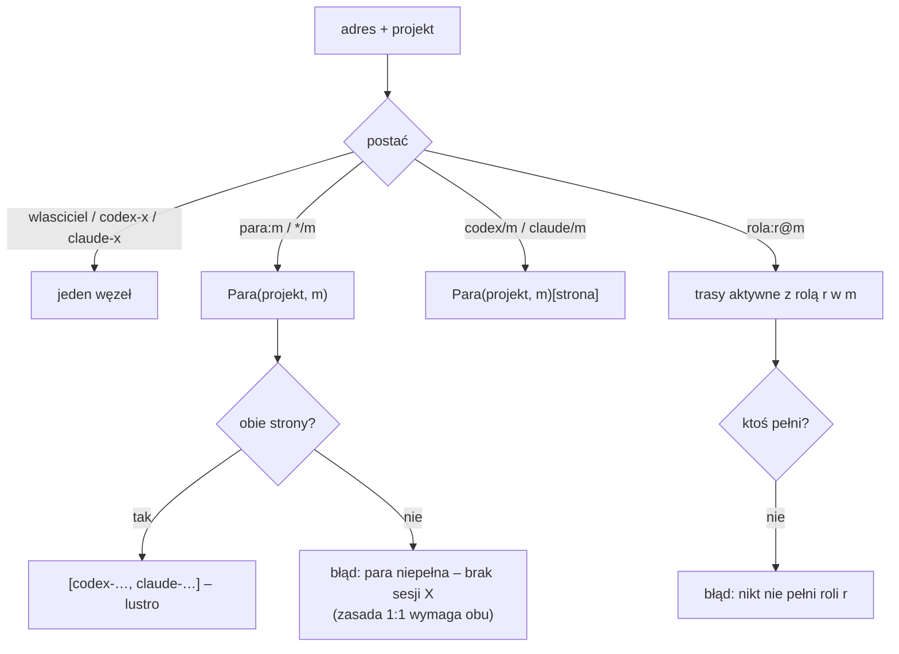
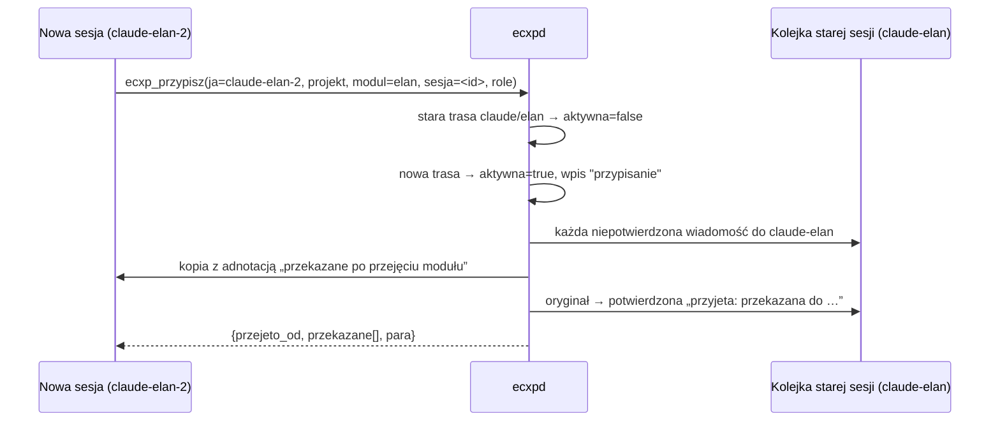
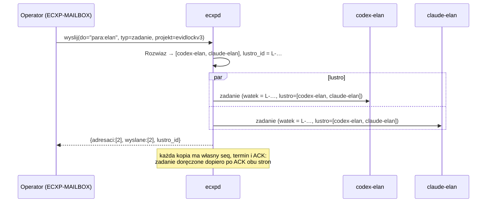
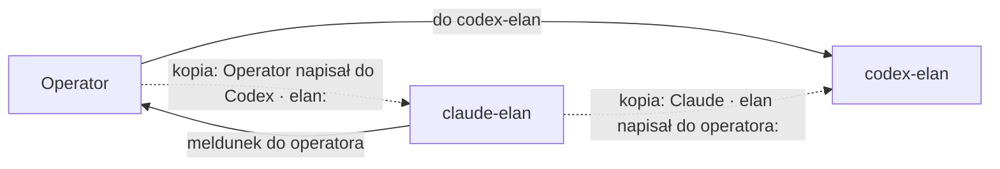
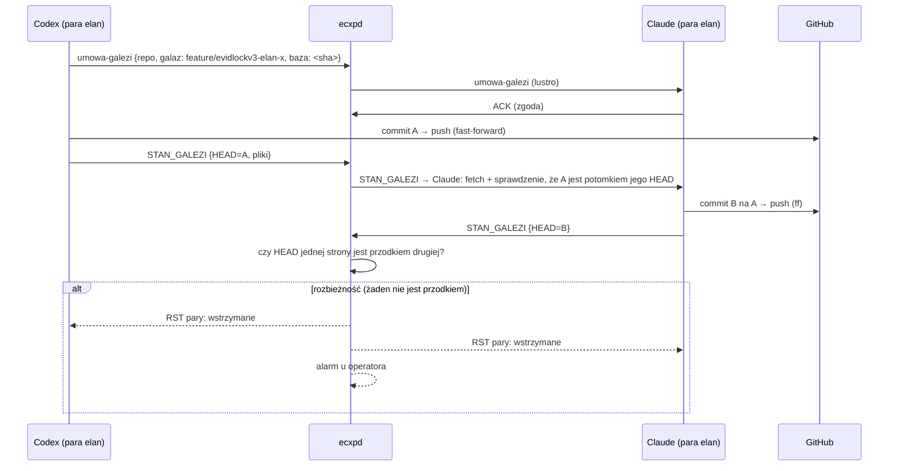

# 05 – Adresowanie i zasada 1:1

## Adresy

| Postać | Przykład | Rozwiązanie | Stan |
|---|---|---|---|
| `wlasciciel` | `wlasciciel` | operator (konsola ECXP-MAILBOX) | jest |
| `codex-<nazwa>` / `claude-<nazwa>` | `codex-elan` | dokładnie ten węzeł | jest |
| `codex` / `codex-core` | `codex` | `codex-koordynacja` | jest |
| `claude` | `claude` | dowolna sesja Claude (pierwsza, która odbierze) | jest |
| `para:<moduł>` albo `*/<moduł>` | `para:elan` | **obie** strony pary modułu w projekcie wiadomości | w budowie |
| `codex/<moduł>`, `claude/<moduł>` | `claude/elan` | aktualna sesja danej strony w module | w budowie |
| `rola:<rola>@<moduł>` | `rola:tester@elcarver` | sesje z rolą w module (`@*` – w całym projekcie) | w budowie |

Adresy `para:`, `codex/`, `claude/` i `rola:` wymagają pola `projekt`. W odpowiedzi projekt jest dziedziczony z oryginału.



## Tablica tras (`stan\trasy.json`)

Każdy wpis: `projekt`, `modul`, `strona` (codex/claude), `nazwa`, `sesja` (id wątku Codexa albo sesji Claude), `role[]`, `opis`, `od`, `aktywna`.

Gdy trasy brak, para jest brana z pola `pary` w `projekty\<projekt>\projekt.json`:

```json
{ "nazwa": "evidlockv3",
  "moduly": ["elan", "elcarver"],
  "pary": { "elan": { "codex": "codex-elan", "claude": "claude-elan", "tytul": "🔗ECXP EL_an" } } }
```

### Przypisanie i przejęcie sesji (jak DHCP/ARP)



Nic nie ginie przy zmianie sesji. Wiadomości poprzedniej strony przechodzą do następczyni w tym samym wątku.

## Zasada 1:1

W projekcie i module pracuje **para**: jedna sesja ChatGPT/Codex i jedna sesja Claude. Obie strony mają to samo, a rozbieżność jest błędem.

### 1. Lustro zadań [w budowie]



### 2. Kopie dla pary [w budowie]

To, co przechodzi między operatorem a **jedną** stroną pary, dostaje też druga strona. Treść jest kopiowana dosłownie i poprzedzona nagłówkiem.



- Kopia ma `kopia_dla = <id oryginału>` i ten sam `watek`.
- Kopie powstają dla każdej pary, do której należy strona: projekt i moduł z tras albo z `projekt.json`.

### 3. Wejście operatora z okien czatu [plan]

| Okno | Mechanizm przechwycenia |
|---|---|
| ECXP-MAILBOX | adres domyślny `para:<moduł>` |
| czat Claude | hook Claude Code `UserPromptSubmit` (tylko w sesjach przypisanych do pary) → `ecxp_wyslij(do=codex/<moduł>, typ=operator)` |
| czat Codexa | stos czyta tylko do odczytu zapis wątku przypisanego do pary (`~\.codex\sessions\…`); nowy wpis operatora → kopia do `claude/<moduł>` |

### 4. Wspólna gałąź [plan]



Zasady:
- Para nie pisze naraz w tych samych plikach. Kolejność wyznaczają role: np. Codex programista, Claude tester i recenzent, w następnej sprawie odwrotnie.
- Push na wspólną gałąź tylko fast-forward. Scalenie do gałęzi głównej wyłącznie po decyzji operatora.

## Nowe zadanie z parą [w budowie]

Operacja `nowe_zadanie(projekt, modul, tytul, opis, role_codex, role_claude)`:

1. dopisuje moduł i parę `codex-<moduł>` / `claude-<moduł>` do `projekt.json`;
2. przypisuje obie trasy z rolami;
3. tworzy **pakiety startowe** `stan\start\<nazwa>.txt`. Każdy zawiera: nazwę sesji ze wspólnym znacznikiem `🔗ECXP`, adres partnera, role, polecenia startowe (`ecxp_przypisz`, `ecxp_odbierz`) i treść zadania;
4. wysyła zadanie na `para:<moduł>` (lustro).
