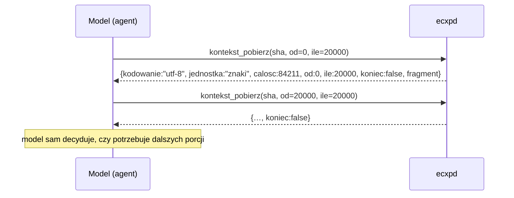
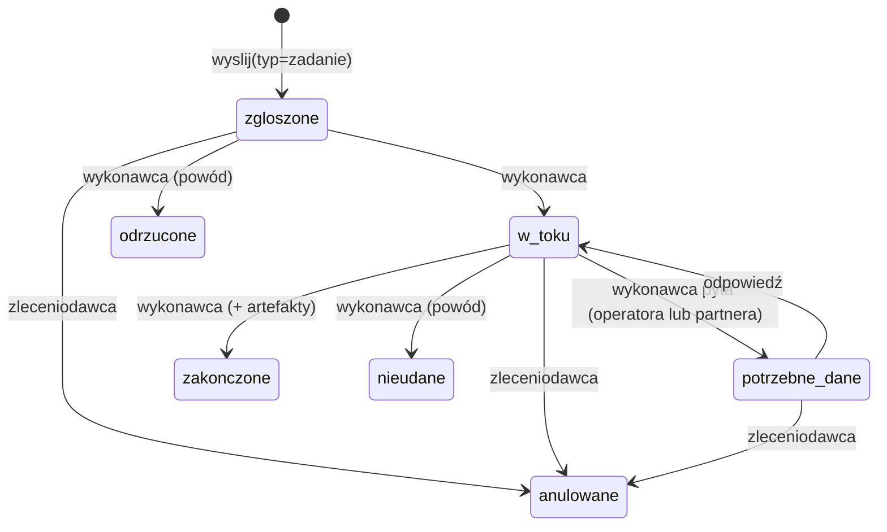

# 06 – Kontekst, zadania, role, karty (L3)

Stan: kod w `Protokol.cs` i `Siec.cs` **[w budowie]**.

Cel warstwy: przenosić kontekst pracy między modelami **niskopoziomowo**, czyli w porcjach, z kontrolą integralności i rozmiaru, bez przeklejania całych rozmów. Model danych jest zgodny pojęciowo z A2A (Task, Message/Part, Artifact, contextId, Agent Card).

## Wiadomość: pola warstwy 3

```json
{
  "protokol": "ecxp/1",
  "id": "20261031-104215-elan-KROK3-a1b2",
  "seq": 3,
  "czas": "2026-10-31T10:42:15.123+01:00",
  "od": "codex-elan",
  "do": "claude-elan",
  "projekt": "evidlockv3",
  "modul": "elan",
  "typ": "zadanie",
  "status": "QUESTION",
  "temat": "KROK3",
  "pilne": false,
  "watek": "L-20261031104200-9f3",
  "kontekst_id": "L-20261031104200-9f3",
  "odpowiedz_na": "…",
  "uwagi": "treść dla człowieka i modelu",
  "czesci": [
    {"rodzaj": "tekst", "tekst": "…"},
    {"rodzaj": "dane", "schemat": "ecxp/przekazanie", "dane": {"…": "…"}},
    {"rodzaj": "plik", "sha256": "e3b0…", "nazwa": "diff.patch", "typ": "text/x-diff", "rozmiar": 18342}
  ],
  "zadanie": {"id": "20261031-104215-elan-KROK3-a1b2", "stan": "zgloszone"},
  "termin_potwierdzenia_min": 240,
  "skrot": "<SHA-256>"
}
```

| Pole | Odpowiednik A2A |
|---|---|
| `czesci[]` (tekst, dane, plik) | `Message.parts[]` (TextPart, DataPart, FilePart) |
| `kontekst_id` | `contextId` |
| `zadanie.id`, `zadanie.stan` | `Task.id`, `TaskStatus.state` |
| obiekt kontekstu z `ecxp_zadanie(artefakty)` | `Artifact` |
| karta węzła | `AgentCard` |

Limity części: najwyżej 50 części, część `dane` do 200 kB. Większe dane trafiają do obiektów kontekstu.

## Obiekty kontekstu adresowane skrótem

```
kontekst\obiekty\<pierwsze 2 znaki sha>\<sha256>
```

- **Niezmienne**: plik ma atrybut tylko do odczytu, a ten sam bajt-po-bajcie obiekt zapisuje się raz (deduplikacja).
- **Weryfikowane przy każdym pobraniu**: SHA-256 przeliczany z bajtów. Niezgodność to błąd „obiekt uszkodzony – nie używaj”.
- **Do 32 MB.** Ścieżki wyglądające na sekrety lub dowody są odrzucane przy imporcie: `.ssh`, `.gnupg`, `.aws`, `auth.json`, `.credentials`, `id_rsa`, `id_ed25519`, `.pem`, `.pfx`, `.p12`, `.key`, `.env`, `secret`, `\dowody\`.

### Pobieranie porcjami (kontrola tokenów po stronie modelu)



- Tekst UTF-8 jest liczony w **znakach**: domyślnie 20 000, najwyżej 100 000 na porcję.
- Dane binarne są liczone w **bajtach** i kodowane base64: najwyżej 48 000 B na porcję.

## Pakiet przekazania pracy (`ecxp/przekazanie`)

Część `dane` wiadomości. Daje drugiej stronie pary albo następczyni pełny, zwarty stan roboczy:

```json
{
  "cel": "…", "stan": "…",
  "repozytorium": "D:/Projekty/evidlockv3", "galaz": "feature/evidlockv3-elan-x", "commit": "<sha 40>",
  "pliki": [{"sciezka": "src/…", "sha256": "…"}],
  "decyzje": ["…"], "ograniczenia": ["…"], "otwarte_pytania": ["…"],
  "kontrole": ["[PASS] cargo test --locked – 512/512", "[FAIL] …"],
  "kontekst": ["<sha256 obiektów>"]
}
```

## Zadania (A2A Task)



- Stan zmienia **wykonawca** (adresat zadania). Zleceniodawca może tylko anulować.
- Każda zmiana daje wpis `zadanie` w dzienniku i automatyczne powiadomienie drugiej strony z częścią `ecxp/stan-zadania` i artefaktami.

## Role

Definicje leżą w `stan\role\<rola>.json` jako `{nazwa, obowiazki, wynik, granice}` i są edytowalne w konsoli. Domyślne:

| Rola | Obowiązki | Wynik | Granice |
|---|---|---|---|
| programista | zmiany na wspólnej gałęzi pary | commit + pakiet przekazania | bez push na gałąź główną, scalania i tagów |
| recenzent | niezależna recenzja zmiany drugiej strony | werdykt z uwagami | nie recenzuje własnej zmiany |
| tester | bramki projektu i testy okien | raport PASS/FAIL z poleceniami | FAIL/BLOCKED raportuje bez zmian |
| bezpieczenstwo | przegląd zmian wrażliwych | raport zagrożeń | bez danych spraw i sekretów |
| koordynator | kieruje sprawy do par i ról | przydziały | nie zmienia kodu |
| integrator | scalanie i wydania | commit scalający + raport bramek | push, scalenie, tagi tylko po decyzji operatora |

Nadanie roli (`rola`) przypisuje trasę i wysyła sesji **kartę roli**, czyli wiadomość z częścią `ecxp/karta-roli`. Zawiera ona definicję, opis od operatora i przypomnienie zasady 1:1.

## Karty węzłów (A2A Agent Card)

`stan\karty\<nazwa>.json` zawiera: `protokol`, `nazwa`, `opis`, `moduly[]`, `umiejetnosci[]`, `dostep: "mcp:ecxp"`, `aktualizacja`. Węzeł publikuje kartę narzędziem `ecxp_karta`, a koordynator i konsola kierują sprawy według kart.
