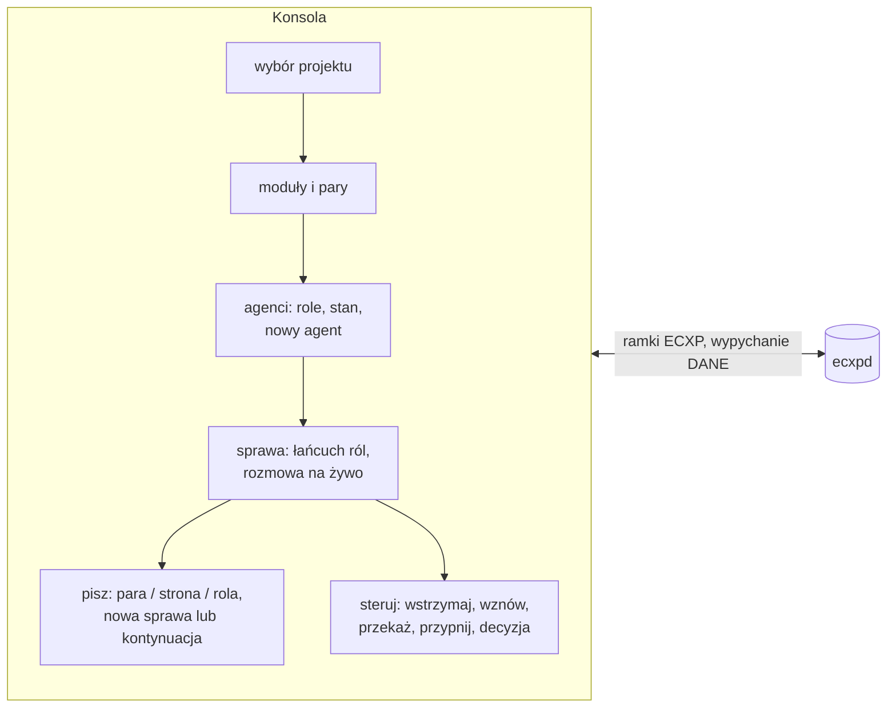

# 07 – Adapter MCP i konsola operatora

## Adapter `ecxp-mcp.exe` [w budowie]

Serwer MCP na **stdio**: JSON-RPC 2.0, jedna wiadomość na linię, UTF-8. Na stdout trafiają wyłącznie odpowiedzi JSON-RPC, a diagnostyka idzie na stderr. Adapter jest klientem stosu `ecxpd` (patrz [03](03-polaczenia.md)), więc nie pisze bezpośrednio w skrzynce.

Obsługiwane metody: `initialize` (wersja protokołu MCP odbijana od klienta, domyślnie `2025-06-18`), `notifications/initialized`, `ping`, `tools/list`, `tools/call`, `resources/list`, `prompts/list`, paczki (batch).

### Narzędzia

| Narzędzie | Wymagane | Opis |
|---|---|---|
| `ecxp_przypisz` | ja, projekt, modul | sesja zgłasza, że prowadzi moduł (trasa, rola, id sesji). Przejmuje kolejkę poprzedniczki |
| `ecxp_odbierz` | ja | wiadomości dla węzła: najpierw pilne, potem od najstarszej. Wpis `dostarczona`. Pole `integralnosc`. Części wiadomości (`czesci`): plik dostaje `sciezka` – kopię tylko do odczytu w `kontekst\zalaczniki\` pod własną nazwą; obrazy (do 5 MB, po sprawdzeniu SHA-256) adapter dołącza do wyniku jako treść obrazu |
| `ecxp_wyslij` | ja, do, typ, tresc | adresy z [05](05-adresowanie-i-para-1-1.md). Lustro i kopie dla pary. `odpowiedz_na` potwierdza oryginał |
| `ecxp_potwierdz` | ja, id, wynik | ACK: `obsluzona` \| `przyjeta` \| `odrzucona`, idempotentne |
| `ecxp_stan` | ja | ile czeka na węzeł, los wysłanych, węzły, karty, spójność dziennika |
| `ecxp_trasy` | – | pary, trasy i role projektu |
| `ecxp_watek` | id | cała rozmowa sprawy w kolejności czasu |
| `ecxp_kontekst_zapisz` | ja + (tresc \| sciezka) | obiekt kontekstu → `sha256` |
| `ecxp_kontekst_pobierz` | ja, sha256 | porcja obiektu (`od`, `ile`) |
| `ecxp_przekaz` | ja, do, … | pakiet przekazania pracy `ecxp/przekazanie` |
| `ecxp_zadanie` | ja, id, stan | zmiana stanu zadania + artefakty |
| `ecxp_karta` | ja | publikacja karty węzła |
| `ecxp_sygnal` | ja | sygnał życia bez odbioru |

Pole `ja` ma postać `codex-<nazwa>` albo `claude-<nazwa>`. Nazwy `wlasciciel` i `ecxp-straznik` są **zastrzeżone**, a adapter je odrzuca.

### Przykład rozmowy MCP

```json
→ {"jsonrpc":"2.0","id":1,"method":"initialize","params":{"protocolVersion":"2025-06-18"}}
← {"jsonrpc":"2.0","id":1,"result":{"protocolVersion":"2025-06-18","capabilities":{"tools":{"listChanged":false}},
     "serverInfo":{"name":"ecxp","title":"ECXP – Evidsec Context eXchange Protocol","version":"…"},"instructions":"…"}}
→ {"jsonrpc":"2.0","id":2,"method":"tools/call","params":{"name":"ecxp_wyslij",
     "arguments":{"ja":"codex-elan","do":"claude/elan","projekt":"evidlockv3","modul":"elan","typ":"pytanie","tresc":"…"}}}
← {"jsonrpc":"2.0","id":2,"result":{"content":[{"type":"text","text":"{\"id\":\"…\",\"seq\":4,\"termin_potwierdzenia_min\":240,…}"}],"isError":false}}
```

Błąd protokołu ECXP (np. para niepełna) zwraca `isError: true` z opisem w `content`. Nie jest to błąd JSON-RPC.

### Rejestracja (planowana)
- **Codex**: `~\.codex\config.toml` → `[mcp_servers.ecxp] command = '<skrzynka>\narzedzia\ecxp-mcp.exe'`
- **Claude Code**: `claude mcp add --scope user ecxp -- "<skrzynka>\narzedzia\ecxp-mcp.exe"`

## Konsola `ECXP-MAILBOX.exe`

Klient stosu z rolą `operator`. Operatora rozpoznaje stos po obrazie procesu (patrz [08](08-bezpieczenstwo.md)). Konsola nie jest protokołem, tylko jedną z aplikacji.



| Funkcja | Stan |
|---|---|
| rozmowy w wątkach, kolory typów, stan doręczenia, filtry, wyszukiwanie | jest |
| „Napisz” i „Odpowiedz”: projekt, moduł, adresat (para / strona / rola), rodzaj, pilne – przez stos | jest |
| załączniki: plik, zrzut ekranu (wszystkie monitory), obraz lub pliki ze schowka → obiekty kontekstu SHA-256 → części `plik`; otwieranie po sprawdzeniu skrótu, typy wykonywalne tylko pokazywane w folderze | jest |
| „⊘ Zamknij wątek…”: operator zamyka całe wątki zaznaczonych wiadomości, także niedoręczone i pytania bez odpowiedzi; pliki trafiają do `archiwum\RRRR-MM` (nic nie jest kasowane), w dzienniku `potwierdzona` z wynikiem `wycofana` i `zarchiwizowana`, strażnik przestaje upominać (operacja stosu `wycofaj`, tylko operator) | jest |
| Ctrl+V / Shift+Insert w oknach z załącznikami (Napisz, Nowe zadanie): obraz lub pliki ze schowka trafiają do załączników, tekst do pola; przeciąganie plików na okno | jest |
| czytelny widok rozmowy: bloki wiadomości, większa treść z wcięciem, załączniki do kliknięcia, dane techniczne drobno | jest |
| motyw jasny / ciemny (pasek tytułu, listy, zakładki, logo), zapamiętany w ustawieniach operatora | jest |
| spis gałęzi jako strona HTML+JS: grupy A–F, filtry, wyszukiwanie, sortowanie, gałęzie z kolorowym stanem, bieżący stan katalogów | jest |
| „Wyczyść”: archiwizacja przeczytanych do `archiwum\RRRR-MM\`, nic nie kasuje | jest |
| zakładka Połączenia: węzły, ostatni kontakt, ocena | jest |
| pary 1:1 obok siebie, role, nowe zadanie z parą, załącznikami i pakietami startowymi, znaczniki 🔗ECXP | jest |
| lista rozmów z nagłówkami kolumn „TYTUŁ” i „WIADOMOŚĆ”; przy każdej rozmowie data i godzina wiadomości, kierunek (od / do) i znacznik: odebrana – „NOWA” albo „✓ przeczytana”; wysłana – „✓ przeczytana przez adresata / obie strony”, „◐ przeczytana 1/2”, „● nieprzeczytana przez adresata” | jest |
| podział „Wszystkie / 📥 Odebrane / 📤 Wysłane” z licznikami (odebrane: także liczba nowych) | jest |
| prawy przycisk na rozmowie: „↪ Wyślij ponownie…” (kopia do poprawy, nowa wersja zastępuje nieodebraną), „➦ Wyślij do Codex / Claude…” (kopia do pary modułu; pola wyboru: oba albo jeden osobno; oryginał zostaje), „⏰ Obudź adresata”, „📂 Pokaż w folderze” (plik wiadomości w widoku `Odebrane` / `Wysłane`, patrz [01](01-architektura.md)), „↩ Odpowiedz…”, „Otwórz w oknie”, „⊘ Zamknij wątek…” | jest |
| „Napisz”: „Potwierdź odebranie” (powiadomienie o dostarczeniu albo niepowodzeniu z opcją „Wyślij ponownie”); moduł ustawia się zgodnie z wybraną parą, przy niezgodności pytanie; przy każdej parze ostatni kontakt obu stron i „⚠ nieaktywna ponad dobę” | jest |
| „📶 Testuj połączenia” („ping” kanału), dla wybranej pary. **Szybki test** (kilka sekund, bez uruchamiania agentów): czas odpowiedzi stosu, spójność dziennika, adapter MCP tak, jak widzą go agenci (`initialize`, `tools/list`, `ecxp_trasy`); dla Codexa i Claude: sesja w parze, ostatni kontakt, rejestracja serwera MCP w aplikacji, sesja do budzenia (operacja stosu `sesja`), zaległe wiadomości. **Pełny test ping–pong** (do 8 min): PING do pary i natychmiastowe budzenie obu sesji; każda potwierdza PING i wysyła PONG drugiej stronie. 8 punktów kontrolnych z czasami (oba kierunki Codex → Claude i Claude → Codex), przy niepowodzeniu powód (np. wątek zajęty w aplikacji Codex). Po teście wiadomości testowe trafiają do archiwum. | jest |
| „Nowe zadanie / moduł”: „＋ Nowy projekt…” (projekt powstaje po wysłaniu zadania i od razu pojawia się w górnym menu „Projekt”), wybór ikony projektu i modułu według kategorii (🖥 aplikacja / kod, 🛡 bezpieczeństwo / testy, 📄 dokumentacja, 🗄 serwer / baza, 🤖 agent, 💡 pomysł / badanie albo brak) – zapis w `projekt.json` (`ikona`, `ikony_modulow`); ikony w menu projektów, filtrze modułów, liście rozmów i agentów, pasku bieżącej sesji, teście połączeń i oknie wiadomości | jest |
| czytnik wybranej wiadomości w osobnym oknie: nagłówek i metadane, suwak 75–250% z zachowaniem miejsca czytania, Segoe UI/Consolas, motyw aplikacji/jasny/konsolowy (czarne tło i biały tekst); „Zapisz jako PDF…”, „Zapisz jako HTML…” i „Kopiuj”. PDF wielostronicowy przez Microsoft Print to PDF w odrębnym procesie, HTML UTF-8 z escapowaniem treści i bez zasobów zewnętrznych. Podgląd rozmowy ma własny suwak, motyw i czcionkę. | jest (3.1) |
| „📷 Zrzut ekranu” (Napisz, Nowe zadanie, szybka odpowiedź): wszystkie monitory, okna konsoli na chwilę ukryte; zrzut trafia do załączników i do schowka (CF_BITMAP / CF_DIB – do wklejenia np. w Paint); Ctrl+V w tym samym oknie nie dodaje go drugi raz | jest |
| „Pobieranie danych” (samo po pierwszym starcie po instalacji – znacznik `stan\po-instalacji.txt` z instalatora – oraz w menu „Ustawienia…”): przycisk „Pobierz dane”, pasek postępu, lista wyników i podsumowanie; sprawdza stos, rejestrację MCP w aplikacjach (ze ścieżką programu), hook i polecenia CLI, wyszukuje sesje Codex i Claude z pakietami ECXP (pierwsza wiadomość operatora, ostatnie 30 dni) i rejestruje je przez stos (operacja `zarejestruj_sesje`: nowa trasa tylko, gdy moduł nie ma sesji tej strony; ta sama nazwa dostaje identyfikator sesji; nic nie jest zastępowane), pokazuje projekty, pary i agentów w tle | jest |
| „🧾 Logi”: moduł obsługi błędów (`Bledy.cs`) zapisuje tylko problemy – błędy, ostrzeżenia, nieobsłużone wyjątki – ze stosem wywołań, wyjątkami wewnętrznymi, kontekstem operacji (np. operacja stosu i jej argumenty), ostatnimi krokami przed błędem i stanem procesu; `stan\logi\mailbox-RRRR-MM-DD.jsonl`, nic nie jest kasowane; przeglądarka z filtrem dnia, poziomu i tekstu, kopiowaniem szczegółów; licznik nieobejrzanych wpisów na przycisku | jest |
| „Bieżąca sesja”: pasek pod nagłówkiem z nazwą pary i stanem zgłoszenia obu stron (✓ / ⏳ / ⚠, np. sesja Claude w chmurze), wyróżnienie ▶ jej rozmów i wiersza agentów, filtr „tylko ta sesja”; ustawiana przez Nowe zadanie, „▶ Ustaw jako bieżącą” albo dwuklik pary | jest |
| Nowe zadanie → sesje w aplikacjach: Codex weryfikuje projekt desktopowy po bezwzględnym katalogu, przypisuje `projectId`, wykonuje pierwszą turę z załącznikami, zwalnia właściciela przez `thread/unsubscribe` i czeka na unload, następnie otwiera `codex://threads/<id>`. Ustawienie `thread_unload_delay_secs=0` dotyczy wyłącznie uruchomionego procesu RPC, nie konfiguracji użytkownika. ECXP nie zapisuje wewnętrznego stanu Codexa. Claude otwiera lokalny folder i pełny pakiet; długi pakiet ma osobną migawkę w `stan/start/pakiety`, bez obcinania do 12000 znaków. W Claude operator sprawdza folder i wysyła przygotowaną wiadomość. | jest (3.1) |
| Wybór agentów (pola „ChatGPT/Codex” i „Claude”) w Nowe zadanie i Napisz: oba = para 1:1 jak dotąd, jeden = tylko ten agent, bez kopii dla drugiego. Przy każdym agencie widać, czy zadanie trafi do istniejącej sesji modułu, czy do nowej. Pasek „Bieżąca sesja” pokazuje niewybraną stronę jako „bez zadania” | jest |
| łańcuchy ról (programista → tester → recenzent → decyzja → integrator), wznowienie | jest ([09](09-decyzje-lancuchy-galezie-lustro-agenci.md)) |
| agenci w tle (Claude Code CLI; Codex CLI, jeśli jest), uprawnienia, limit tur, alarm przy błędzie | jest |
| podpisane decyzje operatora („Decyzja…”), kolumny wspólnej gałęzi i łańcucha w zakładce Agenci, instalator stanowiska | jest |
| status agentów CLI (Claude Code CLI: `claude auth status`; Codex CLI: `codex login status`) w nagłówku okna, w zakładce Agenci i na pasku stanu; przyciski działają w tle, bez okien konsoli: „Zainstaluj…” – instalacja przez npm po potwierdzeniu, „Zaloguj (w tle)” – logowanie (otwiera się tylko strona logowania w przeglądarce), „▶ Agent w tle…” – agent jako usługa stosu; wyjście CLI trafia do `stan\cli-<nazwa>.log`; status odświeża się co 10 s i pokazuje „aktywne” | jest |
| menu ikony w zasobniku (prawy klawisz): projekt, stan stosu, „Nowe dla Ciebie”, pełne okno, Napisz, Nowe zadanie, Decyzja, podmenu „Status agentów CLI” z akcją dla każdego CLI, „Sprawdź status teraz” i dziennikiem usług, zakładki Agenci / Połączenia / Stan modułów, spis gałęzi, język, motyw, O programie, instalator, folder skrzynki, Zakończ; menu buduje się przy każdym otwarciu | jest |
| tryb przykładowy do zrzutów: `ECXP-MAILBOX.exe /demo <katalog> 1|2 [en]` – wymyślony projekt demo-app, bez prawdziwych danych | jest |
| usługi Claude i Codex (agenci w tle jednej strony): Start / Stop / Uruchom ponownie z konsoli i z menu zasobnika; Stop przerywa trwającą turę i wstrzymuje kolejne, restart kasuje przerwę po błędzie; stan w `stan\uslugi.json`; dwa widoki: A – pasek w nagłówku, B – karty usług (prawy klawisz przełącza) | jest |
| „⏻ Zakończ usługi” (pasek, karty, menu zasobnika) i „Zakończ” konsoli: całkowite zamknięcie wszystkich procesów agentów z drzewami potomnymi – aplikacje Claude i Codex, Claude Code, CLI (także przez node), adaptery ecxp-mcp, agenci w tle ECXP; konsola i stos ecxpd są chronione; okno potwierdzenia pokazuje, co zostanie zamknięte; po „Zakończ” usługi, które działały, wznawia następny start konsoli (operacje stosu `uslugi_zakoncz`, `uslugi_po_starcie`); podgląd bez zamykania: `ECXP-MAILBOX.exe /procesy-agentow <plik>` | jest |
| instalator stanowiska `ECXP-Setup.exe` (jeden plik, programy jako zasoby): kreator PL/EN/FR/CS/DE, instalacja dla użytkownika do `%LOCALAPPDATA%\ECXP`, rejestracja w Claude Code i Codex, autostart, skróty, wpis w Aplikacjach; aktualizacja i odinstalowanie zostawiają dane; odinstalowanie i opcje „bez skrótu” zmieniają tylko to, co wskazuje na własny katalog; tryb cichy `/cicho [/katalog] [/jezyk] [/bez-rejestracji] [/bez-autostartu] [/bez-pulpitu] [/bez-uruchomienia]`, `/odinstaluj [/cicho]`, podgląd stron `/demo 1|2|3` | jest |
| języki interfejsu: polski, angielski, francuski, czeski, niemiecki (słownik `narzedzia/zrodlo/jezyki.json` w zasobach programu, wybór w nagłówku, zapamiętany); treści wiadomości agentów nie są tłumaczone | jest |
| okno „O programie” (About): wersja, opis ECXP i ECXP-MAILBOX, odnośniki do evidsec.pl, evidsec.pl/ecxp/ i repozytorium | jest |

Testy: `ECXP-MAILBOX.exe /selftest <pusty katalog>` (rdzeń protokołu) i `ECXP-MAILBOX.exe /selftest-stos <pusty katalog>` (operator przez prawdziwy stos: para, lustro, kopie 1:1, przejęcie, role, załącznik). Spis gałęzi bez okna: `ECXP-MAILBOX.exe /spis-galezi [/ciemny]`.
