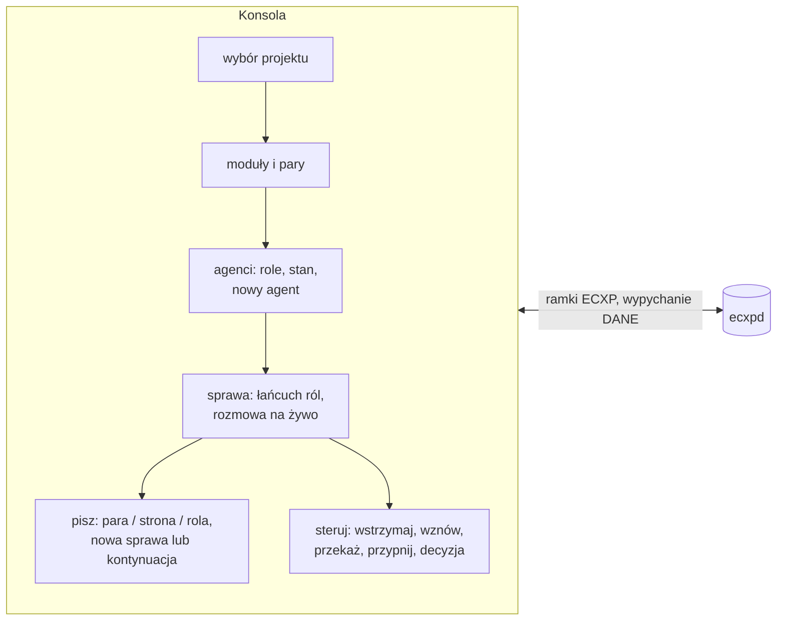

# 07 – Adapter MCP i konsola operatora

## Adapter `ecxp-mcp.exe` [w budowie]

Serwer MCP na **stdio**: JSON-RPC 2.0, jedna wiadomość na linię, UTF-8. Na stdout trafiają wyłącznie odpowiedzi JSON-RPC, a diagnostyka idzie na stderr. Adapter jest klientem stosu `ecxpd` (patrz [03](03-polaczenia.md)), więc nie pisze bezpośrednio w skrzynce.

Obsługiwane metody: `initialize` (wersja protokołu MCP odbijana od klienta, domyślnie `2025-06-18`), `notifications/initialized`, `ping`, `tools/list`, `tools/call`, `resources/list`, `prompts/list`, paczki (batch).

### Narzędzia

| Narzędzie | Wymagane | Opis |
|---|---|---|
| `ecxp_przypisz` | ja, projekt, modul | sesja zgłasza, że prowadzi moduł (trasa, rola, id sesji). Przejmuje kolejkę poprzedniczki |
| `ecxp_odbierz` | ja | wiadomości dla węzła: najpierw pilne, potem od najstarszej. Wpis `dostarczona`. Pole `integralnosc` |
| `ecxp_wyslij` | ja, do, typ, tresc | adresy z [05](05-adresowanie-i-para-1-1.md). Lustro i kopie dla pary. `odpowiedz_na` potwierdza oryginał |
| `ecxp_potwierdz` | ja, id, wynik | ACK: `obsluzona` \| `przyjeta` \| `odrzucona`, idempotentne |
| `ecxp_stan` | ja | ile czeka na węzeł, los wysłanych, węzły, karty, spójność dziennika |
| `ecxp_trasy` | – | pary, trasy i role projektu |
| `ecxp_watek` | id | cała rozmowa sprawy w kolejności czasu |
| `ecxp_kontekst_zapisz` | ja + (tresc \| sciezka) | obiekt kontekstu → `sha256` |
| `ecxp_kontekst_pobierz` | ja, sha256 | porcja obiektu (`od`, `ile`) |
| `ecxp_przekaz` | ja, do, … | pakiet przekazania pracy `ecxp/przekazanie` |
| `ecxp_zadanie` | ja, id, stan | zmiana stanu zadania + artefakty |
| `ecxp_karta` | ja | publikacja karty węzła |
| `ecxp_sygnal` | ja | sygnał życia bez odbioru |

Pole `ja` ma postać `codex-<nazwa>` albo `claude-<nazwa>`. Nazwy `wlasciciel` i `ecxp-straznik` są **zastrzeżone**, a adapter je odrzuca.

### Przykład rozmowy MCP

```json
→ {"jsonrpc":"2.0","id":1,"method":"initialize","params":{"protocolVersion":"2025-06-18"}}
← {"jsonrpc":"2.0","id":1,"result":{"protocolVersion":"2025-06-18","capabilities":{"tools":{"listChanged":false}},
     "serverInfo":{"name":"ecxp","title":"ECXP – Evidsec Context eXchange Protocol","version":"…"},"instructions":"…"}}
→ {"jsonrpc":"2.0","id":2,"method":"tools/call","params":{"name":"ecxp_wyslij",
     "arguments":{"ja":"codex-elan","do":"claude/elan","projekt":"evidlockv3","modul":"elan","typ":"pytanie","tresc":"…"}}}
← {"jsonrpc":"2.0","id":2,"result":{"content":[{"type":"text","text":"{\"id\":\"…\",\"seq\":4,\"termin_potwierdzenia_min\":240,…}"}],"isError":false}}
```

Błąd protokołu ECXP (np. para niepełna) zwraca `isError: true` z opisem w `content`. Nie jest to błąd JSON-RPC.

### Rejestracja (planowana)
- **Codex**: `~\.codex\config.toml` → `[mcp_servers.ecxp] command = '<skrzynka>\narzedzia\ecxp-mcp.exe'`
- **Claude Code**: `claude mcp add --scope user ecxp -- "<skrzynka>\narzedzia\ecxp-mcp.exe"`

## Konsola `ECXP-MAILBOX.exe`

Klient stosu z rolą `operator`. Operatora rozpoznaje stos po obrazie procesu (patrz [08](08-bezpieczenstwo.md)). Konsola nie jest protokołem, tylko jedną z aplikacji.



| Funkcja | Stan |
|---|---|
| rozmowy w wątkach, kolory typów, stan doręczenia, filtry, wyszukiwanie | jest |
| „Napisz” i „Odpowiedz”: projekt, moduł, adresat, rodzaj, pilne | jest, przechodzi na stos |
| „Wyczyść”: archiwizacja przeczytanych do `archiwum\RRRR-MM\`, nic nie kasuje | jest |
| zakładka Połączenia: węzły, ostatni kontakt, ocena | jest |
| pary 1:1 obok siebie, role, nowe zadanie z parą i pakietami startowymi | w budowie |
| łańcuchy ról (programista → tester → recenzent → decyzja → integrator) | plan |
| tworzenie agentów (Claude Code CLI w tle, sesja w aplikacji, Codex: pakiet startowy) | plan |
| decyzje podpisane (ramka DECYZJA) | plan, czeka na decyzję właściciela |

Test protokołu: `ECXP-MAILBOX.exe /selftest <pusty katalog>`.
