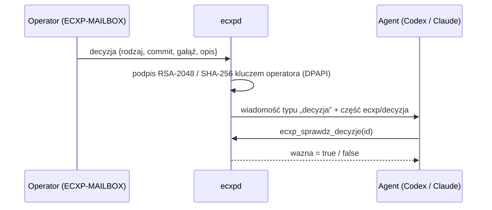
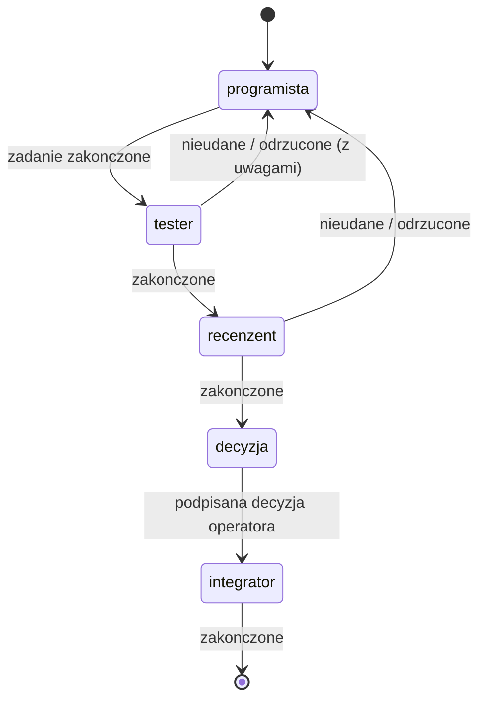

# 09 – Decyzje, łańcuchy ról, wspólna gałąź, lustro czatów, agenci w tle, instalacja

Ten rozdział opisuje funkcje ECXP 1.1. Wszystkie działają w stosie `ecxpd`, a konsola i adapter MCP są tylko ich klientami.

## Podpisane decyzje operatora

Decyzje operatora (push, scalenie, USER_ACCEPTED, usunięcie, zmiana wymagań, krok łańcucha) można wydawać z konsoli zamiast w czacie.

- **Tylko operator.** Decyzję wydaje wyłącznie operator z konsoli, a stos rozpoznaje go po obrazie procesu. Wiadomości typu `decyzja` nie wyśle żaden agent ani zwykłe „Napisz”.
- **Klucz operatora.** `stan\klucz-operatora.dpapi` to klucz RSA-2048 zaszyfrowany przez Windows DPAPI, dostępny tylko dla konta użytkownika. Klucz publiczny leży w `stan\klucz-operatora.pub.xml`.
- **Wymagany commit.** USER_ACCEPTED, push i scalenie wymagają pełnego hasha commitu (40 znaków).
- **Obowiązek agenta.** Przed wykonaniem agent sprawdza podpis: `ecxp_sprawdz_decyzje`. Każda zmiana treści unieważnia podpis.
- **Moc decyzji.** Decyzja z ważnym podpisem ma moc decyzji operatora wydanej w czacie, ale tylko w zakresie dokładnie w niej opisanym.

## Łańcuchy ról

Stan łańcucha zapisuje plik `stan\lancuchy\<id>.json`. Domyślny łańcuch: `programista → tester → recenzent → decyzja → integrator`.

- **Kolejne kroki.** Każdy krok to zadanie wysłane na adres `rola:<rola>@<moduł>`. Agent kończy zadanie przez `ecxp_zadanie(stan=…)`, a stos sam przekazuje sprawę dalej.
- **Brak wykonawcy.** Gdy nikt nie pełni danej roli, łańcuch staje i operator dostaje alarm. W konsoli: Agenci → Nadaj role, a potem „Wznów parę / łańcuch”.
- **Tworzenie.** Łańcuch tworzy „Nowe zadanie” z wypełnionym polem łańcucha albo polecenie `lancuch`. Pierwszy krok trafia tylko do roli, a nie do całej pary.

## Wspólna gałąź pary

1. **Umowa** (`ecxp_umowa_galezi`): jedna strona proponuje repozytorium, gałąź i commit bazowy, a druga potwierdza tymi samymi wartościami. Umowa trafia do `stan\galezie\<projekt>__<moduł>.json`.
2. **STAN_GALEZI** (`ecxp_stan_galezi`): po każdym commicie strona zgłasza HEAD. Stos porównuje go:
   - z commitem bazowym;
   - z HEAD drugiej strony (`git merge-base --is-ancestor`, tylko odczyt).
3. **Rozbieżność**, czyli sytuacja, gdy żaden HEAD nie jest przodkiem drugiego albo HEAD nie wyrasta z bazy:
   - para zostaje wstrzymana, a agenci nie mogą zlecać sobie nowych zadań;
   - operator i obie strony dostają pilny alarm `ROZBIEZNOSC-GALEZI`;
   - parę wznawia operator w konsoli.
4. **Nowy HEAD**: druga strona dostaje informację o nowym HEAD z prośbą o synchronizację.

## Lustro wpisów operatora z okien czatów (zasada 1:1)

Wpis operatora w oknie czatu jednej strony pary trafia dosłownie do drugiej strony jako wiadomość `CZAT-CLAUDE` lub `CZAT-CODEX` w tym samym projekcie i module.

| Źródło | Jak ECXP je czyta |
|---|---|
| Claude Code | Hook `UserPromptSubmit` uruchamia `narzedzia\hook-claude.ps1` (PowerShell, około 0,4 s). Hook rozpoznaje sesję pary po pakiecie startowym („Twoja nazwa w ECXP: claude-…”) albo po wywołaniu `ecxp_przypisz` w zapisie rozmowy. W sesjach spoza ECXP niczego nie zapisuje. Wpis trafia do `stan\wejscia\`, a stos go przekazuje. |
| ChatGPT/Codex | Stos czyta, tylko do odczytu, zapis rozmów `%USERPROFILE%\.codex\sessions\**\rollout-*.jsonl` (inną ścieżkę można podać w zmiennej `ECXP_CODEX_SESSIONS`). Wpis operatora to wiadomość użytkownika w turze wywołanej z okna (`turn_trigger` = `composer`) albo odpowiedź na pytanie agenta. Pomijane są automatyzacje, kontekst środowiska i pakiet startowy. |

## Agenci w tle

- **Uruchomienie.** Konsola: Agenci → „Agent w tle…”, polecenie `uruchom_agenta`. Stos uruchamia agenta, gdy w jego kolejce czekają wiadomości. Działa jedna tura naraz, a limit tur na godzinę ustawia operator. Po nieudanej turze stos czeka 10 minut i wysyła operatorowi alarm z przyczyną.
- **Claude**:
  - polecenie: `claude -p --output-format json --mcp-config <stan\agenci\<nazwa>.mcp.json> --strict-mcp-config --append-system-prompt-file <karta agenta> --allowedTools …`;
  - przy pierwszej turze `--session-id`, przy kolejnych `--resume`;
  - polecenie dla agenta trafia na standardowe wejście.
- **Uprawnienia**:
  - `odczyt`: ECXP oraz Read, Grep, Glob;
  - `edycja`: dodatkowo Edit i Write (tryb `acceptEdits`);
  - `pelne`: dodatkowo Bash.
  Push, scalenie i tagi wymagają podpisanej decyzji.
- **Codex**: `codex exec --skip-git-repo-check -C <katalog> -`, jeśli na stanowisku jest Codex CLI. Bez niego zostaje pakiet startowy do wklejenia.
- **Warunek**: CLI musi być zalogowane na koncie użytkownika stanowiska. Bez tego stos zgłasza alarm „CLI nie jest zalogowane”.

## Instalacja na innym stanowisku

ECXP nie zależy od jednego komputera ani projektu. Wszystkie ścieżki wynikają z katalogu instalacji (`<katalog>\narzedzia\…`), profilu użytkownika i zmiennej `PATH`.

1. Skopiuj katalog z `narzedzia\` (programy i `hook-claude.ps1`) albo zbuduj go z `narzedzia\zrodlo\buduj.cmd`.
2. Uruchom `ECXP-MAILBOX.exe /instaluj` (albo z menu ikony: „Zainstaluj / napraw rejestrację ECXP”). Instalator:
   - zakłada katalogi;
   - rejestruje serwer MCP `ecxp` w Claude Code (`claude mcp add --scope user`) i w Codexie (`%USERPROFILE%\.codex\config.toml`);
   - dodaje hook lustra czatu w `%USERPROFILE%\.claude\settings.json`;
   - tworzy skróty na pulpicie i w autostarcie.
   Kopie zmienionych plików konfiguracji zapisuje jako `*.przed-ecxp.bak`. Raport trafia do `stan\instalacja.txt`.
3. Dodaj projekt w `projekty\<nazwa>\projekt.json` (nazwa, repozytorium, gałąź, moduły, opcjonalnie pary).
4. `ECXP-MAILBOX.exe /odinstaluj` usuwa rejestracje, hook i skróty, a dane zostawia.

## Testy

- `ECXP-MAILBOX.exe /selftest-stos <pusty katalog>`: strona operatora przez prawdziwy stos (para, lustro, kopie, przejęcie, role, załącznik, łańcuch, decyzja).
- `ECXP-MAILBOX.exe /selftest-agent <katalog testowej instalacji>`: prawdziwa tura agenta w tle (Claude Code CLI, model haiku, tylko odczyt).
- Test strony agentów przez MCP (łańcuch, gałąź, decyzje, lustro Claude i Codex) z katalogu `przyklady/` uruchamia się na kopii instalacji.
